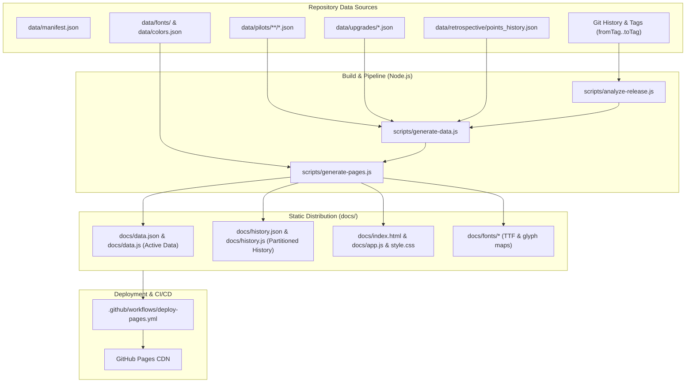

# X-Wing 2.0 Legacy — Points Reference & Retrospective Web Architecture

> **Audience**: AI Agents & Maintainers  
> **Status**: Living Architectural Reference  
> **Last Updated**: October 2026  
> **Repository**: `xwing-data2-legacy` (Branch: `feat/github-pages-reference`)

---

## 1. Executive Overview & Problem Context

Historically, balance changes and points cycles for Star Wars: X-Wing (Second Edition / 2.0 Legacy) were maintained in a multi-tab **Google Spreadsheet**. While the spreadsheet provided a familiar tabular workspace for the community balance committee, it suffered from critical operational issues:

1. **Desynchronization**: Disconnect between the human-edited spreadsheet and the machine-readable JSON files in `xwing-data2-legacy` consumed by squad builders (YASB Legacy, LaunchBayNext, 4-A7 bot).
2. **Lack of Traceability**: Cell values had no audit trail connecting changes to specific Git commit SHAs, PR reviews, or balance rationale.
3. **Ergonomic Limitations**: Cumbersome on mobile devices, no integrated card artwork or ship maneuver dials, and raw text representations instead of canonical X-Wing typography.
4. **Formatting & Data Typos**: Manual naming mismatches and typos (`Depa Billoba`, `Essara Rill`, incorrect `-lsl` vs `standardLoadout` variants).

The **Web-Interpretation Reference** hosted on GitHub Pages ([https://sogemoge.github.io/xwing-data2-legacy/](https://sogemoge.github.io/xwing-data2-legacy/)) solves these challenges by establishing an automated, zero-infrastructure, static single-page application (SPA) compiled directly from the canonical data and Git history upon each release.

---

## 2. End-to-End System Architecture



---

## 3. Subsystem Breakdown

### 3.1 Release Diff Analyzer (`scripts/analyze-release.js`)
* **Execution**: Executed during data generation. Takes `fromRef` (previous tag) and `toRef` (current tag / HEAD).
* **Git-Native Delta Analysis**:
  * Scans `git diff --name-only <fromRef> <toRef> -- data/` to limit parsing solely to changed files.
  * Inspects prior JSON state using `git show <fromRef>:<filePath>`.
  * Detects numeric point changes (`diff = new - old`).
  * Detects non-points errata:
    * Format movements (`standard`, `wildspace`, `epic`).
    * Keyword additions/removals (`keywords` array symmetric difference).
    * Upgrade slot bar alterations (`slots` array comparisons).
    * Initiative shifts and ability wording errata.
* **Commit Interlinking**:
  * Executes `git log <fromRef>..<toRef> --format="%h|%H|%s|%an|%ad" -- <filePath>`.
  * Extracts short SHA, full SHA, message, author, date, and pulls detected PR numbers (`#\d+`).
  * Emits canonical GitHub URLs:
    * Commit: `https://github.com/SogeMoge/xwing-data2-legacy/commit/<fullSha>`
    * Pull Request: `https://github.com/SogeMoge/xwing-data2-legacy/pull/<pr>`

### 3.2 Retrospective Baseline Engine (`scripts/build-retrospective-baseline.js`)
* **Historical Matrix**: Ingests historical data spanning 16 balance cycles dating back to **Sep 21**:
  * Cycles: `Sep 21`, `Apr 22`, `May 22`, `Sep 22`, `Sept 22`, `Oct 22`, `Dec 22`, `Mar 23`, `Sep 23`, `Sept 23`, `Mar 24`, `Sep 24`, `Mar 25`, `Dec 25`, `Mar 26`, `Sep 26`.
* **Disambiguation & Aliasing**: Matches sheet rows against repository `xws` identifiers:
  * Applies normalization (`normalize("NFD")`, stripping accents, quotes, and punctuation).
  * Reconciles committee typos via `ALIASES` map (e.g. `oomuplinkprototype` → `00muplinkprototype`, `kuil` → `kuiil`).
  * Resolves Standard Loadout collisions: differentiates fixed Standard Loadout cards (`standardLoadout: [...]`) from configurable Legacy Standard Loadout cards (`<name>-lsl`).
* **Persistence**: Stored in [`data/retrospective/points_history.json`](file:///g:/xwing-data2-legacy.git/data/retrospective/points_history.json), keyed by `${cardType}:${xws}`.

### 3.3 Data & Site Compilers (`scripts/generate-data.js` & `scripts/generate-pages.js`)
* **Partitioned Bundle Architecture**:
  * Ingests manifests, pilots, upgrades, chassis definitions, font mappings, and git diffs.
  * Emits **primary payload**: [`docs/data.json`](file:///g:/xwing-data2-legacy.git/docs/data.json) and [`docs/data.js`](file:///g:/xwing-data2-legacy.git/docs/data.js) containing all active pilots, upgrades, chassis, dials, format flags, and recent release changes without the historical matrix bloat.
  * Emits **partitioned retrospective history**: [`docs/history.json`](file:///g:/xwing-data2-legacy.git/docs/history.json) (~285 KB) and [`docs/history.js`](file:///g:/xwing-data2-legacy.git/docs/history.js) (~189 KB) containing the 16-cycle historical points matrix keyed by card identifier.
* **Dual Distribution Strategy (Zero-Server `file://` Support)**:
  * In parallel with JSON files, generates `.js` companion files declares (`window.XWING_DATA` and `window.XWING_HISTORY`).
  * When opened via `file:///`, browser CORS security prohibits local `fetch()`. The application gracefully falls back to synchronous globals or dynamic `<script>` injection, providing full offline portability without a web server.
* **Asynchronous On-Demand Lazy Loading**:
  * Initial page load executes in milliseconds since `history.json` is not requested upfront.
  * Clicking **"📜 Show History"**, inspecting a card drawer, or exporting full CSV dynamically triggers `ensureHistoryLoaded()`, binding historical points to the in-memory cards on demand.

### 3.4 Interactive Client (`docs/app.js`, `docs/style.css`, `docs/index.html`)
* **Design & Typography**:
  * Modern cockpit dark theme utilizing SirJorj's canonical color tokens (`data/colors.json`).
  * Custom TTF font icons: `xwing-miniatures.ttf` (arcs, actions, dice, upgrade slots) and `xwing-miniatures-ships.ttf` (ship chassis silhouettes).
  * Dynamic symbol injection: bracketed text like `[Focus]` or `[1 [Straight]]` is converted into styled font glyphs and maneuver chips.
* **Navigation & Filtering**:
  * Faction tabs with official faction glyphs and colors.
  * Generic Upgrades tab with faction-restricted upgrades segregated into their respective factions.
  * Multi-field search (card name, chassis, ability text, keywords).
  * Format selector (Standard, Wild Space, Epic).
  * Change filter (Only Changed, Buffs, Nerfs, Parameter changes).
* **Spreadsheet Emulation ("Show History")**:
  * Toggles 16+ side-by-side historical points columns matching the Google Sheet layout.
  * Dynamic multi-column sorting (Chassis, Name, Cost, Diff).
  * Full CSV export matching the visible tabular state.
* **Chassis Headers & Density**:
  * Pilots grouped by ship chassis with visual header bars showing ship stats and dials.
  * Header toggle button (`showHeaders`) stored in `localStorage` to maximize table density.
* **Card Details Slide-out Drawer**:
  * Full card image/artwork preview.
  * Maneuver dial matrix (speeds 0–5 color-coded: blue, white, red, purple).
  * Errata diff history and full retrospective points history table.

### 3.5 CI/CD & Automated Quality Gates (`.github/workflows/deploy-pages.yml`, `tests/pages.test.js`)
* **Zero-Touch Automation**: Deploys to GitHub Pages on every release publication or push to `master`.
* **Jest Test Suite**:
  * Asserts all static files (`data.json`, `data.js`, `style.css`, font TTFs) exist and are non-empty.
  * Verifies `data.json` invariants: >600 pilots, >400 upgrades, >50 ships, >16 history cycles.
  * Enforces valid commit URLs on all detected changes.

---

## 4. Evaluation vs. Legacy Google Spreadsheet

| Criteria | Google Spreadsheet Workflow | Current Web Reference (`docs/`) |
| :--- | :--- | :--- |
| **Data Integrity** | Prone to desync with repository JSON; manual data entry. | **100% synchronized** with database; compiled directly from source JSON. |
| **Commit Traceability** | None; changes exist without Git context. | **Direct commit & PR interlinks** for every card change. |
| **Game Ergonomics** | Plain text abbreviations (`E`, `1TR`, `Focus`). | **Official X-Wing font icons**, colored maneuver dials, card artwork. |
| **Errata Highlighting** | Hidden in cell comments or inconsistent notes. | **Explicit badges** for format moves, slot changes, keyword edits. |
| **Mobile Friendliness** | Extremely difficult to pan/zoom multi-column sheets. | **Responsive layout** with slide-out drawer, chassis grouping, search. |
| **Editing Capability** | Collaborative multi-user editing directly in cells. | **Read-only**. Changes must be made via Git PR. |

---

## 5. Comparative Architectural Solutions Matrix

| Architecture | Strategy | Data Size & Bandwidth | Query Power | Maintenance & Hosting | Authoring Workflow |
| :--- | :--- | :--- | :--- | :--- | :--- |
| **1. Current Implementation**<br>*(SSG Monolithic SPA)* | Precomputed `data.json` + Vanilla JS/DOM in `docs/` | ~2.5 MB single payload (cached after 1st visit) | In-memory JS array filtering; fast for <2,000 records | **Zero cost**; static GitHub Pages, no server | Read-only consumption. Changes authored in JSON/PRs. |
| **2. Multi-Page Static Site (SSG)**<br>*(Astro / 11ty / Starlight)* | Pre-rendered static HTML routes per chassis, faction, and release | ~30–80 KB per page; assets cached | Static routes + client search index (Pagefind / Stork) | **Zero cost**; GitHub Pages / Cloudflare Pages | Read-only; excellent SEO and deep-linking per card. |
| **3. Client-Side Analytical DB (WASM)**<br>*(DuckDB-WASM / SQLite-WASM)* | Parquet or SQLite binary file loaded into browser WASM engine | ~400 KB DB file + ~1.5 MB WASM engine | **Extremely high**; arbitrary SQL queries, aggregations, trend analysis | **Zero cost**; static hosting of binary assets | Read-only; enables community data scientists to run SQL on balance trends. |
| **4. Edge / Serverless API**<br>*(Cloudflare Workers + D1 / Next.js)* | Headless JSON REST/GraphQL endpoints with edge caching | Dynamic payloads (few KB per query); high initial efficiency | High; server-side pagination, arbitrary git ref diffing | Low to Moderate; requires Cloudflare/Vercel account & edge compute limits | Read-only with potential for authenticated draft preview endpoints. |
| **5. Collaborative Hybrid CMS**<br>*(Directus / Baserow / Sheet-to-Git Sync)* | Web-based relational GUI for committee with two-way Git sync | Synced via Webhooks / GitHub Actions | Medium; standard relational views | Moderate; requires hosting CMS or managing Google Cloud Service Accounts | **Full Replacement**: Committee edits in UI/Sheet, action commits to repo. |
| **6. Partitioned Delta-Patch Architecture**<br>*(Chunked Static JSON)* | `meta.json` + `factions/<id>.json` + lazy-loaded `history.json` | ~60 KB initial load; history loaded on-demand | In-memory JS within active partition | **Zero cost**; static GitHub Pages | Read-only; highly optimized for mobile devices. |

---

## 6. Guide for AI Agents & Maintainers

When updating, debugging, or extending the Pages reference, adhere to the following rules:

### 6.1 Code & Asset Locations
* Master site generator: [`scripts/generate-pages.js`](file:///g:/xwing-data2-legacy.git/scripts/generate-pages.js)
* Data compilation & diffs: [`scripts/generate-data.js`](file:///g:/xwing-data2-legacy.git/scripts/generate-data.js) and [`scripts/analyze-release.js`](file:///g:/xwing-data2-legacy.git/scripts/analyze-release.js)
* Static client app: [`docs/index.html`](file:///g:/xwing-data2-legacy.git/docs/index.html), [`docs/app.js`](file:///g:/xwing-data2-legacy.git/docs/app.js), [`docs/style.css`](file:///g:/xwing-data2-legacy.git/docs/style.css)
* Baseline retrospective data: [`data/retrospective/points_history.json`](file:///g:/xwing-data2-legacy.git/data/retrospective/points_history.json)
* Font assets & glyph mappings: [`data/fonts/`](file:///g:/xwing-data2-legacy.git/data/fonts/) and [`data/colors.json`](file:///g:/xwing-data2-legacy.git/data/colors.json)

### 6.2 Essential Commands
```bash
# 1. Regenerate docs/data.json, docs/data.js, and copy font assets
npm run build:pages

# 2. Run automated validation tests for Pages artifacts
npx jest tests/pages.test.js

# 3. Preview the application locally via HTTP server
npm run serve:pages
```

### 6.3 Critical Invariants
1. **Never commit without running `npm run build:pages`**: Any change to pilots or upgrades in `data/` must be reflected in `docs/data.json` and `docs/data.js`.
2. **Dual-Format Invariant**: Both `docs/data.json` and `docs/data.js` must be generated in tandem to preserve offline `file://` compatibility.
3. **Commit Linking Invariant**: Commit links must use full 40-character SHAs (`https://github.com/SogeMoge/xwing-data2-legacy/commit/<fullSha>`).
4. **Historical Column Order**: In `scripts/generate-data.js`, new points cycles must be prepended to `standardCycleOrder` (newest first).
5. **No Framework Dependencies in `docs/`**: The frontend is intentionally zero-dependency Vanilla JS/CSS to ensure instant loading and zero build complexity.

---

## 7. Recommended Next Evolution Steps

1. **[COMPLETED] Partition Retrospective History (Chunking)**:
   * Extracted the retrospective history matrix from `docs/data.json` into standalone `docs/history.json` and `docs/history.js` bundles.
   * Implemented on-demand lazy loading via `ensureHistoryLoaded()` in `docs/app.js` with button loading indicators, drawer fallback placeholders, and offline `file://` script injection fallback.
2. **URL Deep-Linking**:
   * Implement URL hash routing (e.g. `/#galacticempire/pilot:soontirfel`) to allow direct linking and sharing of specific cards and chassis drawers.
3. **Release Archive Diff Inspector**:
   * Add a dropdown allowing users to select and compare any two arbitrary historical releases (e.g., `3.9.0` vs `3.10.0`), computed from cached tag diff manifests.
