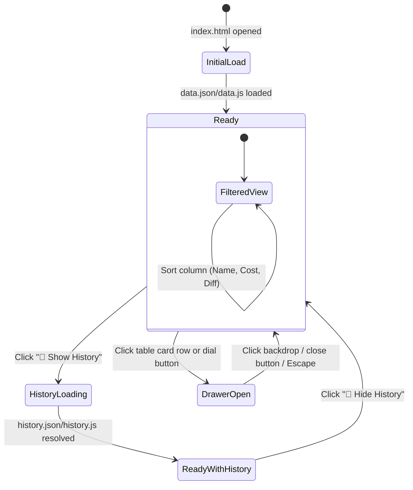

# X-Wing 2.0 Legacy — Web UI/UX Design System & Interaction Specification

> **Audience**: AI Agents, Frontend Developers & UI/UX Designers  
> **Status**: Living Design Specification  
> **Last Updated**: October 2026  
> **Location**: [`docs/`](file:///g:/xwing-data2-legacy.git/docs/)  

---

## 1. Design Philosophy & Aesthetic Identity

The **X-Wing 2.0 Legacy Points Reference** website is engineered to replace the legacy Google Spreadsheet with a modern, high-performance, dark tactical interface inspired by ship cockpits and military Star Wars Heads-Up Displays (HUDs).

### Core Pillars
1. **Canonical Accuracy**: Color palettes, game symbols, ship silhouettes, and maneuver dials conform strictly to official Second Edition / 2.0 Legacy standards documented by [SirJorj](https://xhud.sirjorj.com/xwing.cgi/colors2).
2. **High Information Density with Visual Breathing Room**: Replicates the tabular efficiency of a spreadsheet while introducing structural visual hierarchy: chassis headers, colored initiative tags, upgrade slot glyphs, and maneuver dial matrices.
3. **Cockpit HUD Dark Mode**: Deep space navy/slate backgrounds (`#0f141c`, `#171f2b`) with subtle luminous borders (`#273549`) that reduce eye fatigue during long squad-building and balance analysis sessions.
4. **Micro-Interactions & Tactical Feedback**: Hover elevations, smooth drawer slides, sticky headers, and instant fuzzy filtering make the UI responsive and tactile.
5. **Zero-Server Portability**: Built using pure Vanilla HTML5, CSS3, and modern ES6 JavaScript with zero external frameworks or runtime dependencies, functioning seamlessly offline via `file:///` and online via GitHub Pages CDN.

---

## 2. Design Tokens & Visual Variables

All design tokens are centralized in [`docs/style.css`](file:///g:/xwing-data2-legacy.git/docs/style.css) under `:root` and synced with [`data/colors.json`](file:///g:/xwing-data2-legacy.git/data/colors.json).

### 2.1 Surfaces, Backgrounds & Borders

| Token | Hex Value | Purpose / Usage |
| :--- | :--- | :--- |
| `--bg-primary` | `#0f141c` | Global viewport background, active tab surface, card detail inner section |
| `--bg-secondary` | `#171f2b` | Application header, toolbar background, table wrapper container, drawer |
| `--bg-tertiary` | `#1f2a3a` | Buttons, badges, neutral counter chips, interactive pill backgrounds |
| `--bg-card` | `#151c27` | Inner card containers and elevated panel surfaces |
| `--border-color` | `#273549` | Primary structural borders, table outer border, toolbar boundaries |
| `--border-subtle`| `#1c2736` | Table row dividers, historical column separators, dial cell grid |

### 2.2 Typography Colors

| Token | Hex Value | Contrast & Role |
| :--- | :--- | :--- |
| `--text-main` | `#e2e8f0` | High-contrast body copy, pilot names, active titles (Slate 200) |
| `--text-muted` | `#94a3b8` | Column headers, descriptions, secondary stats, passive labels (Slate 400) |
| `--text-dim` | `#64748b` | Card captions, flavor text, empty placeholders, dial speed labels (Slate 500) |

### 2.3 Faction Identity Palette

Each faction features a canonical accent color and corresponding glyph code from `data/colors.json`:

| Faction Key | Canonical Hex | Font Glyph | Glyph Symbol | Tab CSS Class |
| :--- | :--- | :--- | :--- | :--- |
| **Rebel Alliance** | `#cb120e` | `!` | Rebel Crest | `.tab-rebel` |
| **Galactic Empire** | `#d6d6dd` | `@` | Imperial Cog | `.tab-empire` |
| **Scum & Villainy** | `#f4d118` | `#` | Scum Mandible | `.tab-scum` |
| **Resistance** | `#d87325` | `!` | Starbird Variant | `.tab-resistance` |
| **First Order** | `#b42828` | `+` | First Order Crest | `.tab-firstorder` |
| **Galactic Republic** | `#4faddd` | `/` | Republic Cog | `.tab-republic` |
| **Separatist Alliance**| `#337ab7` | `.` | CIS Hexagon | `.tab-separatist` |
| **Generic Upgrades** | `#fdbf10` | `m` | Modification Wrench | `.tab-upgrades` |
| **Recent Changes** | `#38bdf8` | `⚡` | Lightning Bolt | `.tab-changes` |

### 2.4 Official X-Wing 2.0 Stat & Attribute Tokens

Sourced directly from SirJorj's Second Edition specification:

| Attribute | CSS Token | Hex Value | Visual Component |
| :--- | :--- | :--- | :--- |
| **Initiative** | `--xwing-initiative` | `#e77e29` | Orange pilot initiative badges (e.g., `[6]`, `[5]`) |
| **Cost / Points** | `--xwing-cost` | `#41bef0` | Cyan current points typography in table & drawer |
| **Attack / Arcs** | `--xwing-attack` | `#ed3638` | Red attack value, hit/crit symbols, primary arc glyphs |
| **Agility** | `--xwing-agility` | `#6abe46` | Bright green agility pill & evade symbol |
| **Hull** | `--xwing-hull` | `#f0e531` | Yellow hull pill & damage symbol |
| **Shields** | `--xwing-shield` | `#82d1e1` | Light cyan shield pill & token symbol |
| **Charge** | `--xwing-charge` | `#fdbf10` | Gold charge counter pill & recurring charge symbol |
| **Force** | `--xwing-force` | `#c4a0ca` | Soft purple force capacity pill & force charge symbol |
| **Energy** | `--xwing-energy` | `#e71583` | Magenta energy pill for huge ships |

### 2.5 Difficulties & Maneuvers

| Difficulty | CSS Token | Hex Value | Maneuver Dial Class |
| :--- | :--- | :--- | :--- |
| **Blue (Destress)** | `--xwing-destress` | `#1e90ff` | `.maneuver-blue` (blue tint + border) |
| **White (Neutral)** | `--xwing-neutral` | `#ffffff` | `.maneuver-white` (subtle white glow) |
| **Red (Stress)** | `--xwing-stress` | `#ec1f21` | `.maneuver-red` (red stress tint) |
| **Purple (Force)** | `--xwing-force-action`| `#c4a0ca` | `.maneuver-purple` (purple force tint) |

### 2.6 Balance & Diff Badges

| Change Type | Background | Text Color | Border | Badge Class |
| :--- | :--- | :--- | :--- | :--- |
| **Points Buff** (Cheaper) | `#064e3b` (Dark Emerald) | `#6ee7b7` | `rgba(16, 185, 129, 0.4)` | `.diff-buff` |
| **Points Nerf** (Costlier) | `#7f1d1d` (Dark Crimson) | `#fca5a5` | `rgba(239, 68, 68, 0.4)` | `.diff-nerf` |
| **Format / Errata Change**| `#25446e` (Soft Blue) | `#93c5fd` | `#3b82f6` | `.param-changed-badge` |
| **New Card** | `#064e3b` | `#a7f3d0` | `#10b981` | `.diff-new` |
| **Variable Cost Updated** | `#312e81` (Indigo) | `#c7d2fe` | `#6366f1` | `.diff-changed` |

---

## 3. Typography & Custom Font System

The application relies on two custom TrueType fonts and system-native font fallbacks:

```text
docs/fonts/
├── xwing-miniatures.ttf          # Game icons (arcs, actions, dice, slots, tokens)
├── xwing-miniatures-ships.ttf    # Ship silhouettes (T-65, TIE/ln, Falcon, etc.)
├── icons-map.json                # JSON unicode mapping for game icons
└── ships-map.json                # JSON unicode mapping for ship chassis
```

### 3.1 Font Stacks
* **System UI Font Stack (`--font-sans`)**:
  `-apple-system, BlinkMacSystemFont, "Segoe UI", Roboto, "Helvetica Neue", Arial, sans-serif`
  * Used for: Titles, labels, navigation tabs, card text, button labels.
* **Monospace Stack (`--font-mono`)**:
  `ui-monospace, SFMono-Regular, Menlo, Monaco, Consolas, "Liberation Mono", monospace`
  * Used for: Commit hashes (`#51cfeb2`), point values, diff numbers (`+4`, `-2`), initiative values, dial speeds.
* **Game Icon Font (`'xwing-miniatures'`)**:
  * Used for: Upgrade slot icons, action symbols, dice results, maneuver arrows.
* **Ship Silhouettes Font (`'xwing-miniatures-ships'`)**:
  * Used for: Ship silhouette icons in chassis headers and table cells (scales on hover via `transform: scale(1.15)`).

### 3.2 Dynamic In-Text Symbol Parser (`renderGameText()`)
Card abilities in `xwing-data2-legacy` use bracketed notation. `docs/app.js` automatically parses and renders these into styled vector glyphs:

```text
Input Text in JSON                Rendered HTML Output
---------------------------------------------------------------------------------------------------------
"[Focus]"                      →  <span class="game-symbol-glyph symbol-action">f</span> (White Focus icon)
"[Evade]"                      →  <span class="game-symbol-glyph symbol-evade">e</span> (Green Evade icon)
"[Hit]"                        →  <span class="game-symbol-glyph symbol-hit">d</span> (Red Hit icon)
"[Crit]"                       →  <span class="game-symbol-glyph symbol-crit">c</span> (Red Critical Hit icon)
"[1 [Straight]]"               →  <span class="maneuver-template-chip"><span class="maneuver-speed">1</span>...</span>
"[Talent]"                     →  <span class="game-symbol-glyph symbol-slot">E</span> (Gold Talent icon)
```

---

## 4. Layout Architecture & UI Components

The application viewport is split into five functional vertical tiers:

```
+-----------------------------------------------------------------------+
| 1. App Header: Brand Title, Subtitle, Release Badge, Commit, Sheet Link|
+-----------------------------------------------------------------------+
| 2. Faction Tabs Nav: [⚡ Recent] [Rebel] [Empire] [Scum] ... [Upgrades] |
+-----------------------------------------------------------------------+
| 3. Controls Toolbar: [🔍 Search] [Format ▼] [Change ▼] [Chassis ▼]    |
|                      [🏷️ Headers] [📜 History] [📥 Export CSV]        |
+-----------------------------------------------------------------------+
| 4. Stats Banner: "Showing 45 cards | Click row for details"          |
+-----------------------------------------------------------------------+
| 5. Sticky Data Table Wrapper:                                         |
|    - Chassis Header Rows (Stats, size, dial button, count)            |
|    - Card Rows (Format, Chassis, Pilot/Upgrade, Slots, Points, Diff)  |
|    - Historical Columns (Sep 26, Mar 26, Dec 25... when enabled)     |
+-----------------------------------------------------------------------+
| [Slide-out Drawer]: Card Art, Dial Matrix, Stats Bar, Errata, Timeline |
+-----------------------------------------------------------------------+
```

### 4.1 Header (`.app-header`)
* Brand logo uses the T-65 X-wing silhouette (`x`) in red (`#ef4444`).
* Pill badges on the right display current release version (`Release 3.12.0`), short commit SHA (`commit #51cfeb2`), repository link, and Google Sheet reference.

### 4.2 Faction Navigation Bar (`.tabs-nav`)
* Horizontally scrollable bar with styled tab buttons (`.tab-btn`).
* Active tab features a 3px colored bottom border matching the faction's canonical color.
* Each tab button contains:
  1. Vector faction glyph (`.tab-faction-glyph`).
  2. Faction title.
  3. Pill counter (`.tab-count`) displaying total pilots + upgrades.

### 4.3 Controls Toolbar (`.toolbar`)
* **Live Search (`.search-input`)**: Real-time debounce-free filtering matching card name, chassis, ability text, keywords, and caption.
* **Filter Selectors (`.select-filter`)**:
  * *Format*: All Formats, Standard, Wild Space, Epic.
  * *Changes*: All Cards, Only Changed Cards, Buffs, Nerfs, Parameter Changes.
  * *Chassis/Slot*: Dynamically grouped optgroups based on current active tab.
* **Action Buttons (`.btn-secondary`)**:
  * `🏷️ Show/Hide Headers`: Toggles `.hide-chassis-headers` class on `dataTable` and persists choice in `localStorage('xwing_show_headers')`.
  * `📜 Show/Hide History`: Lazy-loads `docs/history.json` and injects 16 historical cycle columns.
  * `📥 Export CSV`: Serializes currently filtered rows into a standard CSV download.

### 4.4 Data Table (`.data-table`)
* **Sticky Header (`position: sticky; top: 0; z-index: 10`)**: Header stays fixed while table scrolls vertically within `.table-wrapper`.
* **Chassis Header Row (`.chassis-header-row`)**:
  * Deep horizontal gradient (`#182333` → `#111827`).
  * Ship silhouette vector glyph.
  * Base size chip (`SMALL`, `MEDIUM`, `LARGE`, `HUGE`).
  * Compact stat pills (Attack, Agility, Hull, Shields, Energy).
  * Maneuver Dial inspector button (`.chassis-dial-btn`).
  * Pilot count badge (`.chassis-pilot-count`).
* **Card Row (`.clickable`)**:
  * Hover highlight (`rgba(255, 255, 255, 0.03)`).
  * Soft blue highlight (`.cell-highlight-blue`) with blue left border for cards modified in the latest points cycle.
  * Pilot initiative badge (`.pilot-init-badge`) with white-on-orange contrast.
  * Unique dot indicators (`•`, `••`, `•••`) in gold (`#f59e0b`).
  * Slot bar rendering mini glyphs with tooltips.
  * Points diff badge (`.diff-buff`, `.diff-nerf`, or neutral).
  * Commit chip (`#<sha>`) linking directly to the Git commit on GitHub.

### 4.5 Card & Chassis Detail Drawer (`.drawer`)
* Slides smoothly from the right edge (`animation: slideIn 0.25s ease-out`).
* Closes via `&times;` close button, background backdrop click, or `Escape` keypress.
* **Content Hierarchy**:
  1. Card Face Artwork / Pilot Photo (with drop shadow).
  2. Ship Stats Pill Bar (colored by canonical stat tokens).
  3. Ship Actions Bar (White, Red, Purple difficulties).
  4. Card Ability & Ship Ability text (with embedded game glyphs).
  5. **Maneuver Dial Matrix Table**: 8-column layout (Speeds 5 to 0; Left Turn, Left Bank, Straight, Right Bank, Right Turn, K-Turn/Stationary, S-Loop/T-Roll Left & Right) color-coded by bearing difficulty.
  6. Restrictions & Keyword Chips.
  7. Errata & Parameter change breakdown with commit links.
  8. Full Retrospective Points Timeline table.

---

## 5. Interaction Patterns & State Management



### 5.1 Sorting Logic
* Columns supporting ascending/descending sort: `Type/Chassis`, `Name`, `Cost`, `Diff`.
* Within each chassis group, pilots sort by:
  1. Primary selected sort column.
  2. Default: Initiative descending (`I6` → `I1`), uniqueness descending (`•••` → `•` → generic), points descending, then alphabetical.

### 5.2 Responsive Breakpoints
* **Desktop (>1024px)**: Full dual-column toolbar, max-height table viewport, slide-out drawer max-width 600px.
* **Tablet (768px - 1024px)**: Auto-wrapping toolbar filters, table wrapper horizontal scroll active.
* **Mobile (<768px)**:
  * Header and toolbar collapse into a single vertical column.
  * Search input expands to 100% width.
  * Drawer spans 100% viewport width.
  * Sticky table headers remain active with horizontal scrolling.

---

## 6. Guidelines for AI Agents Modifying the UI/UX

When extending, styling, or fixing components in `docs/`:

1. **Never Hardcode Colors**: Always use predefined CSS variables (`var(--accent-blue)`, `var(--xwing-initiative)`, etc.) or look up canonical values from `data/colors.json`.
2. **Preserve Font Vector Consistency**:
   * Use `'xwing-miniatures'` for game mechanisms, slots, actions, dice, and tokens.
   * Use `'xwing-miniatures-ships'` for chassis silhouettes and ship logos.
   * Do not replace vector glyphs with generic Unicode emojis when a canonical game font exists.
3. **Maintain High Density**: Do not inflate cell padding excessively; tabletop players and tournament organizers use this reference to scan dozens of cards simultaneously. Keep `.data-table td` padding within `0.35rem - 0.5rem`.
4. **Offline `file:///` Invariant**:
   * Never introduce runtime imports or dynamic fetches that fail under `file:///` CORS without a script-tag injection fallback.
5. **No Heavy Frameworks**: Keep the client application in Vanilla JavaScript (`docs/app.js`). Do not introduce React, Vue, Svelte, or external UI component libraries.
